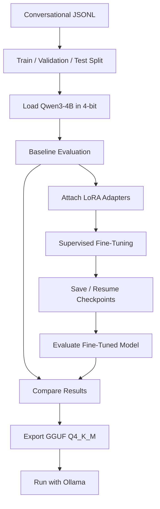

<div align="center">

# Qwen PRIME 4B AI

**A Qwen3-4B model fine-tuned for coding assistance — with a quantized GGUF export for local inference.**

[](https://huggingface.co/Qwen/Qwen3-4B-Instruct-2507)
[](https://github.com/unslothai/unsloth)
[](https://huggingface.co/docs/peft/index)
[](https://ollama.com/)


</div>

## Overview

Qwen PRIME 4B AI adapts [`Qwen3-4B-Instruct-2507`](https://huggingface.co/Qwen/Qwen3-4B-Instruct-2507) using **supervised fine-tuning (SFT)** and **QLoRA/LoRA**.

- **Training:** Google Colab with an NVIDIA T4 GPU
- **Dataset:** conversational JSONL records using a `messages` field
- **Training stack:** Unsloth, Transformers, TRL, PEFT, Datasets
- **Export:** quantized `Q4_K_M` GGUF
- **Inference:** local Ollama runtime

> This is a fine-tuned model, not a model trained from scratch. Training uses Colab; inference can run locally after the model is downloaded.

## Pipeline



## Dataset format

Each JSONL line contains a conversation:

```json
{
  "messages": [
    {"role": "user", "content": "Write a Python function to reverse a string."},
    {"role": "assistant", "content": "def reverse_string(text):\n    return text[::-1]"}
  ]
}
```

The training workflow uses separate `train`, `validation`, and `test` splits.

- Keep test examples out of training.
- Update dataset paths to match your environment.
- The dataset is not included by default.

## Results

Reported ROUGE scores from the completed run:

| Metric | Base model | Fine-tuned |
|---|---:|---:|
| ROUGE-1 | 21.37% | 30.64% |
| ROUGE-2 | 2.85% | 6.29% |
| ROUGE-L | 9.92% | 18.43% |

**Note:** These scores indicate text overlap, not code correctness. The evaluation used a small test sample, so treat the results as preliminary rather than a comprehensive benchmark.

## Key highlights

- **Parameter-efficient training:** trains LoRA adapters instead of updating every base-model weight.
- **Lower memory use:** 4-bit model loading supports resource-conscious fine-tuning.
- **Checkpoint recovery:** saves progress to persistent Google Drive storage.
- **Before/after comparison:** evaluates the base and fine-tuned model on held-out examples.
- **Portable inference:** exports a quantized GGUF model for Ollama.

## Run locally with Ollama

Requirements: [Ollama](https://ollama.com/) and the exported `.gguf` file.

1. Put the GGUF file in a directory.
2. Create a `Modelfile` beside it:

```dockerfile
FROM ./Qwen3-4B-Instruct-2507.Q4_K_M.gguf
```

3. Import and run:

```bash
ollama create qwen-prime-4b-ai -f ./Modelfile
ollama run qwen-prime-4b-ai
```

Check the installed model:

```bash
ollama list
```

If your GGUF filename differs, update the `FROM` path. Actual speed and memory use depend on context length, system RAM, and GPU offload.

## Reproducing training

1. Open the training notebook in Google Colab and select a GPU runtime.
2. Mount Google Drive if your dataset or checkpoints are stored there.
3. Install compatible library versions and configure dataset/output paths.
4. Confirm all dataset splits load correctly.
5. Run baseline evaluation, fine-tuning, and post-training comparison.
6. Export to GGUF and copy the completed file to persistent storage before the Colab session ends.

Checkpoint recovery requires checkpoint files to have been saved successfully.

## Limitations & privacy

- Fine-tuning does not guarantee correct, secure, or hallucination-free code.
- Results depend on dataset quality and coverage.
- Local Ollama inference can run offline once the model is installed; training is **not fully offline** because it uses Colab and downloads required assets.
- Keep private data and credentials out of public commits.
- Check the base model's licence before redistributing model weights.

## Technology

[](https://huggingface.co/Qwen)
[](https://github.com/unslothai/unsloth)
[](https://github.com/huggingface/transformers)
[](https://github.com/huggingface/trl)
[](https://github.com/huggingface/peft)
[](https://ollama.com/)

---

<div align="center">

**Qwen PRIME 4B AI** · Fine-tuned in the cloud. Ready for local inference.

</div>
