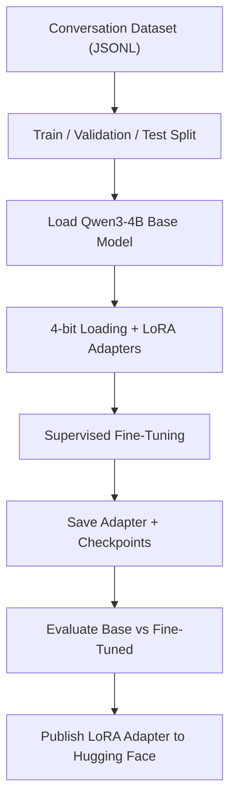

<div align="center">

# Qwen PRIME 4B AI

**A fine-tuned LoRA adapter for Qwen3-4B-Instruct-2507, built for coding-oriented assistance.**

[](https://huggingface.co/primeyyy/Qwen-PRIME-4B-AI)
[](https://huggingface.co/Qwen/Qwen3-4B-Instruct-2507)
[](https://github.com/unslothai/unsloth)


</div>

## Overview

Qwen PRIME 4B AI is a **LoRA adapter** fine-tuned from [`Qwen3-4B-Instruct-2507`](https://huggingface.co/Qwen/Qwen3-4B-Instruct-2507).

- **Training method:** supervised fine-tuning (SFT) with QLoRA/LoRA
- **Training environment:** Google Colab with an NVIDIA T4 GPU
- **Tools:** Unsloth, Transformers, TRL, PEFT, Datasets
- **Published artifact:** adapter weights and configuration on Hugging Face
- **Not included in this repository:** a standalone full model or GGUF export

> **Important:** The files on Hugging Face are adapter weights, not a complete model. Load them together with the compatible base model.

## Fine-tuning pipeline



## Load the adapter

Requirements: Python, PyTorch, and a compatible Transformers/PEFT environment.

Install the core packages:

```bash
pip install torch transformers peft
```

Load the base model and adapter:

```python
import torch
from transformers import AutoModelForCausalLM, AutoTokenizer
from peft import PeftModel

base_model_id = "Qwen/Qwen3-4B-Instruct-2507"
adapter_id = "primeyyy/Qwen-PRIME-4B-AI"

tokenizer = AutoTokenizer.from_pretrained(base_model_id)

base_model = AutoModelForCausalLM.from_pretrained(
    base_model_id,
    torch_dtype="auto",
    device_map="auto",
)

model = PeftModel.from_pretrained(base_model, adapter_id)
model.eval()

messages = [
    {"role": "user", "content": "Write a Python function to reverse a string."}
]
prompt = tokenizer.apply_chat_template(
    messages,
    tokenize=False,
    add_generation_prompt=True,
)
inputs = tokenizer(prompt, return_tensors="pt").to(model.device)

with torch.no_grad():
    outputs = model.generate(**inputs, max_new_tokens=256)

print(tokenizer.decode(
    outputs[0][inputs["input_ids"].shape[1]:],
    skip_special_tokens=True,
))
```

**Hardware note:** the base model is approximately 4B parameters. Memory use depends on precision, context length, and device placement. The example above does not configure 4-bit loading; use a compatible quantization setup if your hardware has limited memory.

## Evaluation

Recorded results from the project run:

| Metric | Base model | Fine-tuned |
|---|---:|---:|
| ROUGE-1 | 21.37% | 30.64% |
| ROUGE-2 | 2.85% | 6.29% |
| ROUGE-L | 9.92% | 18.43% |

These results came from a small test sample and measure text overlap, not code correctness or execution success. Treat them as preliminary.

## What is published?

| Artifact | Status |
|---|---|
| LoRA adapter weights | Available on [Hugging Face](https://huggingface.co/primeyyy/Qwen-PRIME-4B-AI) |
| Adapter configuration | Available on Hugging Face |
| Complete merged model | Not provided in this repository |
| GGUF file for Ollama | Not provided in this repository |
| Training dataset and notebook | Not guaranteed to be included; check repository files |

## Ollama / GGUF

The Hugging Face adapter repository cannot be imported into Ollama directly as though it were a standalone GGUF model.

To use this fine-tuning through Ollama, you need to **merge the adapter with the base model and export the merged model to a compatible GGUF file**. Only then can you create a `Modelfile` pointing to that file, for example:

```dockerfile
FROM ./your-merged-model.gguf
```

Replace the filename with the actual GGUF file you have exported. No GGUF download is linked here because the current Hugging Face repository publishes the adapter, not that file.

## Key highlights

- Parameter-efficient fine-tuning with LoRA/QLoRA.
- Built on Qwen3-4B-Instruct-2507 rather than trained from scratch.
- Base-versus-fine-tuned evaluation recorded.
- Adapter published separately so it can be loaded with the compatible base model.
- Can be merged and exported for other runtimes through a separate conversion workflow.

## Limitations

- Fine-tuning does not guarantee accurate, secure, or hallucination-free code.
- Results depend on the training data and the small evaluation sample.
- Training used Google Colab; this is not an entirely offline training pipeline.
- Review the base model's licence and applicable terms before redistributing merged weights.

---

<div align="center">

**Qwen PRIME 4B AI** · A published LoRA adapter for Qwen3-4B-Instruct-2507

</div>
